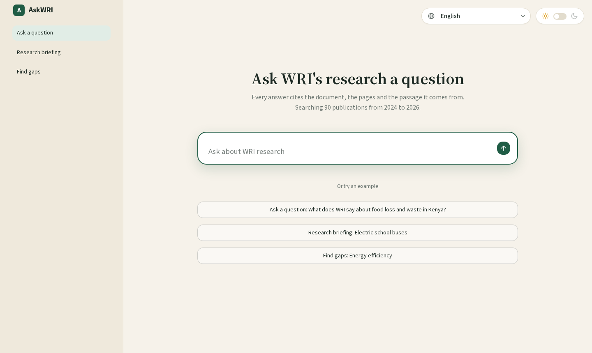
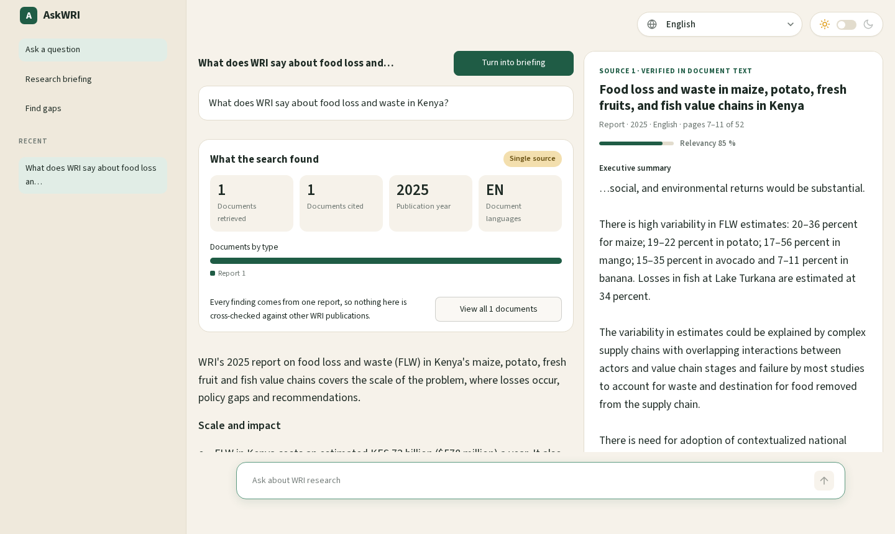

# AskWRI

AskWRI is a chatbot that answers questions from World Resources Institute (WRI) research PDFs, and shows its evidence.



- **Every answer cites its sources**: document, pages and a quoted passage. The quote is checked against the document text, and the source panel highlights it.
- **It says so when the documents don't contain the answer**, instead of guessing.
- **Research briefings**: a table of headline figures first, then the detailed briefing.
- **Gap analysis**: what WRI's research covers on a topic, where it is thin, and what to research next.
- **Documents sorted by relevancy**, using the vector search score (explained [below](#how-relevancy-is-scored)).
- **Six languages for the whole page and the answers**: English, Spanish, French, Portuguese, Chinese and Hindi.
- **Light and dark themes** (light by default).



It runs on AWS (Amazon Bedrock, S3, S3 Vectors, DynamoDB, SQS, Lambda, AgentCore). The chat page is a Streamlit app that you run yourself.

Based on the original AskWRI by [mpaquette-protagona](https://github.com/mpaquette-protagona/ask-wri).

---

## Contents

- [Quick start](#quick-start)
- [How it works](#how-it-works)
- [The chat page](#the-chat-page)
- [The agent](#the-agent)
- [Configuration](#configuration)
- [Repository layout](#repository-layout)
- [Day-to-day tasks](#day-to-day-tasks)
- [Troubleshooting](#troubleshooting)
- [Known limitations](#known-limitations)
- [Tearing it down](#tearing-it-down)

---

## Quick start

### What you need

- **Python 3.12** and `pip`
- **Terraform** 1.5 or newer (tested with 1.17)
- The **AWS CLI**, and AWS credentials that can create the resources below (environment variables, `aws configure`, or SSO). The code uses your default credentials; to use a named profile, set `AWS_PROFILE`.
- **Amazon Bedrock model access in `us-east-1`** for Claude Sonnet 5.5 (`us.anthropic.claude-sonnet-5-5`), Claude Haiku 5.5 (`us.anthropic.claude-haiku-5-5`) and Titan Text Embeddings V2 (`amazon.titan-embed-text-v2:0`).
- Your **PDFs in an S3 bucket** that your credentials can read.

**Use `us-east-1` everywhere.** The models are set up for it and the code is pinned to it. Your shell may default to another region, which makes AWS CLI commands look in the wrong place, so set it for your session:

```bash
export AWS_REGION=us-east-1 AWS_DEFAULT_REGION=us-east-1      # PowerShell: $env:AWS_REGION="us-east-1"; $env:AWS_DEFAULT_REGION="us-east-1"
```

### Step A: edit these values first

| # | File | Line to change | Put |
|---|---|---|---|
| 1 | `terraform/main.tf` | `source_bucket = "wri-publications"` | the S3 bucket that holds your PDFs |
| 2 | `lambdas/sections_handler.py` | `SOURCE_BUCKET = "wri-publications"` | the same bucket |
| 3 | `ingest/common.py` | `SOURCE_BUCKET = "wri-publications"` | the same bucket |
| 4 | `docs_to_ingest.txt` | the list of keys | the PDFs to ingest, one S3 key per line (for example `2024_publications/some-file.pdf`) |

> **Careful with step 4.** The file ships with a list of 90 keys for the `wri-publications` bucket. Replace it with your own. If the file has no keys at all, **every PDF in the bucket is ingested**, which could be hundreds. Start with a handful.

You don't need to edit anything else. The chat page learns your agent's address from an environment variable in step B6.

### Step B: run these in order

All commands run from the repository root. They are the same in bash and PowerShell, except where noted.

**1. Create a virtual environment and install the packages**

```bash
python3.12 -m venv .venv
source .venv/bin/activate          # PowerShell: .venv\Scripts\Activate.ps1
pip install -r requirements.txt
```

**2. Package the agent.** This builds `agent/agent_code.zip`: the agent code plus its libraries, downloaded for AgentCore's Linux ARM64 machines (not for your computer). Terraform uploads it in the next step.

```bash
python agent/build_zip.py
```

**3. Create everything in AWS**: tables, vector index, buckets, queues, Lambdas and the AgentCore agent. Type `yes` when asked. It takes a few minutes.

```bash
cd terraform
terraform init
terraform apply
cd ..
```

**4. Ingest your PDFs.** This only queues them. The Lambdas then work in the background, from about 20 seconds for a short PDF to a few minutes for a long one.

```bash
python ingest/1_start_ingestion.py
```

Wait until the work is finished. Both queues should show 0 messages and the documents table should hold one row per PDF (see [Checking ingestion progress](#checking-ingestion-progress)).

**5. Add the resource type, subtype and page counts** (optional, but it gives the "Report", "Working Paper" labels and "page 9 of 52" in the page). Run it after ingestion has finished. It only updates documents that exist, and skips the rest.

```bash
python ingest/2_backfill_metadata.py
```

The values come from `ingest/doc_metadata.json`, keyed by S3 key, and cover the 90 shipped documents. For other PDFs, add entries in the same format. Documents without an entry still work and show as "Other".

**6. Open the chat page.** Print the agent's address, give it to the page, and start it:

```bash
terraform -chdir=terraform output -raw agent_runtime_arn
export AGENT_ARN="<paste the arn here>"      # PowerShell: $env:AGENT_ARN="<paste the arn here>"
streamlit run app/streamlit_app.py
```

Go to http://localhost:8501. Type a question in the big box, or click one of the examples.

---

## How it works

```
INGESTION  (turns PDFs into searchable data)

  you run: python ingest/1_start_ingestion.py
     │  one SQS message per PDF
     ▼
  Lambda "askwri-sections"
     • Claude Haiku reads the whole PDF and splits it into English sections
       (non-English documents are translated; the original language is recorded)
     • Claude picks tags, regions and topics, but ONLY from fixed lists (lambdas/labels.py)
     • saves one text file per section in S3
     • saves the document's details in DynamoDB
     │  one SQS message per section
     ▼
  Lambda "askwri-embed"
     • cuts the section into ~2,000-character chunks
     • turns each chunk into a vector (Amazon Titan embeddings)
     • stores the vectors in S3 Vectors

CHAT

  Streamlit page ──► AgentCore Runtime ──► agent/agent.py
   (your computer)                          the page's mode picks the agent:
                                              Ask question / Research briefing ─► research agent
                                              Find gaps ───────────────────────► gaps agent
```

**The key idea:** chunks are only used to *find* the right place. The agent answers from the *whole section* a chunk came from, which is stored as a text file in S3.

---

## The chat page

| Where | What |
|---|---|
| **Start screen** | A large question box in the middle of the page, with three examples below it. |
| **Left menu** | Ask a question, Research briefing, Find gaps, and your recent questions. Click the **AskWRI** logo to go back to the start screen. |
| **Top right** | A language dropdown (it shows only the chosen language) and a light/dark switch (sun and moon). |
| **Answer** | A "What the search found" card (documents browsed and documents used in the answer, publication years, document languages, used documents by type), then the answer with numbered citation chips. |
| **View all N documents** | The documents the answer used, most relevant first, each with its relevancy and the passages that were cited. Documents the search browsed but the answer did not use are only counted ("The answer uses 3 of the 5 documents the search browsed"), not listed. |
| **Source panel** | On the right, only after an answer has cited sources. It shows the passage with the supporting quote highlighted and a status: *verified in document text*, *verified in translated text*, or *quote not found in text*. Pick another source with the chips under the answer. |
| **Turn into briefing** | Re-runs a question as a research briefing. |

**Language.** The language you pick sets the whole page *and* the language the answer is written in. Quotes stay in the language of the passage they come from. Documents that were not written in English are stored as an English translation, so their passages are shown in English, with a note saying so.

**Answer times.** In testing, questions took about 10 to 30 seconds, briefings about 25 seconds, and gap analyses about 40 seconds.

---

## The agent

### What it can do

| Tool | What it does |
|---|---|
| `search_wri` | Finds the most relevant sections. Give a text query (semantic search) and/or filters: `region`, `topic`, `tag`, or `document` (a document id). Returns up to 5 sections per call, best match first. |
| `list_documents` | Lists the documents in the library (id, title, year, regions, topics, tags). The gaps agent uses it to see what exists. |

Limits per question: the research agent searches at most 5 times and the gaps agent at most 12 times, a section is never given to the agent twice, and citation numbers are unique. The allowed values for `region`, `topic` and `tag` are built into the tool definitions, so the agent cannot invent one.

The agent remembers the last four questions of a conversation, so follow-ups such as "what about Uganda?" work. That memory lives in the running session. AgentCore ends a session after 15 minutes without use, and the memory goes with it.

### How relevancy is scored

The vector search returns the closest chunks with a cosine distance. AskWRI turns that into a similarity:

```
similarity = 1 - cosine distance          (1.0 means identical)
```

- A **section's** relevancy is the similarity of its best-matching chunk.
- A **document's** relevancy is the relevancy of its best section.
- Documents and sections are sorted by it, highest first, and shown as a percentage.

The score measures how close the text is to your question, not whether the text is correct. In testing, on-topic questions scored 70 to 85 % for their best passage, and an unrelated question scored about 15 %. The search always returns its closest matches, even weak ones, which is why a document can be retrieved but not cited.

### How citations are checked

The model writes the answer with `[n]` markers and, at the end, one short quote per cited source. The agent then:

1. takes titles, pages and passages from what the search tool returned, never from the model's text;
2. looks for each quote inside the passage it claims to come from;
3. reports each source as verified or not, and highlights the matching text.

### Calling the agent directly

The page sends this JSON to the agent:

```json
{
  "prompt": "What does WRI say about food loss and waste in Kenya?",
  "mode": "ask",
  "language": "English",
  "filters": {"regions": ["Africa"], "languages": ["en"]}
}
```

`mode` is `ask`, `briefing` or `gaps`. `language` is optional. `filters` is optional and can hold `regions`, `topics`, `subtypes`, `resource_types` and `languages`: values inside one filter are alternatives, different filters must all match. The page does not use filters at the moment.

The reply holds `answer` (the raw text), `body` (the answer without the quotes block), `sources` (one entry per retrieved section: title, year, pages, passage, quote, `cited`, `verified`, `relevancy`), `documents` (the same sources grouped by document and sorted by relevancy) and `stats`.

---

## Configuration

| Setting | Where | Default | Purpose |
|---|---|---|---|
| `AGENT_ARN` | environment | a placeholder containing `account_id` | The hosted agent the page talks to. Set it to `""` to use a local agent. |
| `LOCAL_URL` | environment | `http://localhost:8080/invocations` | Where a local agent listens (only used when `AGENT_ARN` is `""`). |
| `AWS_REGION` | environment | none | Keep `us-east-1` for AWS CLI commands. |
| `AWS_PROFILE` | environment | none | Use a named AWS profile instead of the default credentials. |
| Streamlit theme | `.streamlit/config.toml` | cream and green | Base colours. The dark theme is `app/style_dark.css`. |

---

## Repository layout

```
README.md                  this file
docs/                      screenshots used in this README
requirements.txt           Python packages for the scripts and the chat page
docs_to_ingest.txt         which PDFs to ingest (one S3 key per line; empty = ALL PDFs)
.streamlit/config.toml     Streamlit theme
terraform/                 all infrastructure as code (tables, buckets, queues, Lambdas, the agent, IAM)
lambdas/
  sections_handler.py      Lambda 1: PDF -> section text files + metadata
  embed_handler.py         Lambda 2: section -> chunks -> vectors
  labels.py                the allowed tags, regions and topics
ingest/
  common.py                settings and the reader for docs_to_ingest.txt
  1_start_ingestion.py     sends one SQS message per PDF
  2_backfill_metadata.py   adds resource type, subtype and page counts to the documents table
  doc_metadata.json        those values for the 90 shipped documents
agent/
  agent.py                 the chat agent (runs on AgentCore)
  passages.py              finds and checks the quotes in the model's answer
  build_zip.py             packages the agent into agent_code.zip for Terraform
  labels.py                copy of lambdas/labels.py (keep them identical!)
  requirements.txt         packages the deployed agent needs
app/
  streamlit_app.py         the chat page: layout and behaviour
  ui.py                    builds the HTML of the cards and the source panel
  i18n.py                  all interface text in six languages
  style.css                styling (light theme)
  style_dark.css           styling added on top for the dark theme
```

---

## Day-to-day tasks

### Checking ingestion progress

```bash
# messages waiting or being worked on (both should reach 0 and 0)
for q in askwri-pdf-queue askwri-section-queue; do
  aws sqs get-queue-attributes --queue-url "$(aws sqs get-queue-url --queue-name $q --query QueueUrl --output text)" \
    --attribute-names ApproximateNumberOfMessages ApproximateNumberOfMessagesNotVisible --query Attributes
done

# documents saved so far
aws dynamodb scan --table-name askwri-documents --select COUNT --query Count
```

You can also read the CloudWatch logs of the `askwri-sections` and `askwri-embed` Lambdas.

**Re-ingesting a document replaces everything about it.** Run the ingest script again with the same key and the old vectors, section files and document details are rebuilt from scratch. A `source_url` you typed into the DynamoDB console, and the subtype and page count from the backfill script, are kept.

### Changing the agent

After you edit `agent/agent.py`, `agent/passages.py` or `agent/labels.py`:

```bash
python agent/build_zip.py
terraform -chdir=terraform apply
```

Terraform sees the new zip, uploads it and updates the agent.

### Changing the page

Edit the files in `app/` and the page reloads. Restart `streamlit run` after editing `ui.py` or `i18n.py`, because Streamlit keeps those loaded.

**Adding a language.** In `app/i18n.py`: add it to `UI_LANGUAGES` and `ANSWER_LANGUAGE`, add a full block to `TEXT` (copy the English one), and add its entries to `VALUES` for document types and document-language names.

**Linking to the original documents.** Source panels show an "Open the document" button when a document has a `source_url`. Fill it in with the DynamoDB console or a script.

### Changing the tags, regions or topics

Edit the lists in `lambdas/labels.py` and copy the **identical** file to `agent/labels.py`. Then run `python agent/build_zip.py` and `terraform apply` (this updates both the Lambda and the agent), and re-ingest the documents so they get the new labels.

### Running the agent on your own computer

Terminal 1:

```bash
python agent/agent.py          # serves on http://localhost:8080
```

Terminal 2:

```bash
export AGENT_ARN=""            # PowerShell: $env:AGENT_ARN=""
streamlit run app/streamlit_app.py
```

Port 8080 must be free. If something else uses it, set `LOCAL_URL` to wherever your agent is reachable.

---

## Troubleshooting

| What you see | Likely cause and fix |
|---|---|
| The page says *The agent did not answer (…)* | `AGENT_ARN` is missing, still has `account_id` in it, or points at another region. Print the right one with `terraform -chdir=terraform output -raw agent_runtime_arn`. |
| AWS CLI commands return nothing or *does not exist* | Your shell is in another region. Set `AWS_REGION=us-east-1`. |
| A PDF never appears, and the sections Lambda log says *Model returned bad JSON twice* | The document is long enough that the model's output was cut off. The Lambda allows 64,000 output tokens (`maxTokens` in `lambdas/sections_handler.py`). Failed messages expire after an hour. |
| *Access denied* when ingesting | `source_bucket` and `SOURCE_BUCKET` don't name a bucket your account can read, or the three values in Step A don't match. |
| A change to `ui.py` or `i18n.py` has no effect | Restart `streamlit run`. |
| Chinese or Hindi shows as empty boxes | The device has no font for that script. Install one. |

---

## Known limitations

- **No login.** Anyone who can reach the Streamlit page can use it, with the AWS permissions of whoever started it. Don't expose it publicly as is.
- **No dead-letter queue.** If a PDF keeps failing, SQS retries it until the message expires (1 hour) and then drops it.
- **Search finds close matches, it can't prove something is absent.** "Gaps" always means gaps within the documents that were ingested.
- **There is no minimum relevancy.** The search browses its closest matches even when they are weak. The answer decides which of them to use, and only those are listed, so the "browsed" count can be higher than the "used" count.
- **Tables and figures are ignored** during ingestion; only text is searchable.
- **Long PDFs** must fit in one model call, and their text in one model reply. PDFs up to about 19 MB and 150 pages were ingested in testing, but very long documents may still be cut off.
- **Quotes are checked against the stored text.** For non-English documents that is the English translation, not the original wording.
- **The page's styling depends on Streamlit's internal element names.** It was built and tested with Streamlit 1.66, and an upgrade may need small CSS fixes.
- **Re-ingesting scans the whole vector index** to find the old vectors. That is fine for hundreds of documents but gets slower as the index grows.

---

## Tearing it down

```bash
cd terraform
terraform destroy          # type "yes"; removes everything, including the stored documents and vectors
```

Everything is in Terraform, so this one command removes it all.
